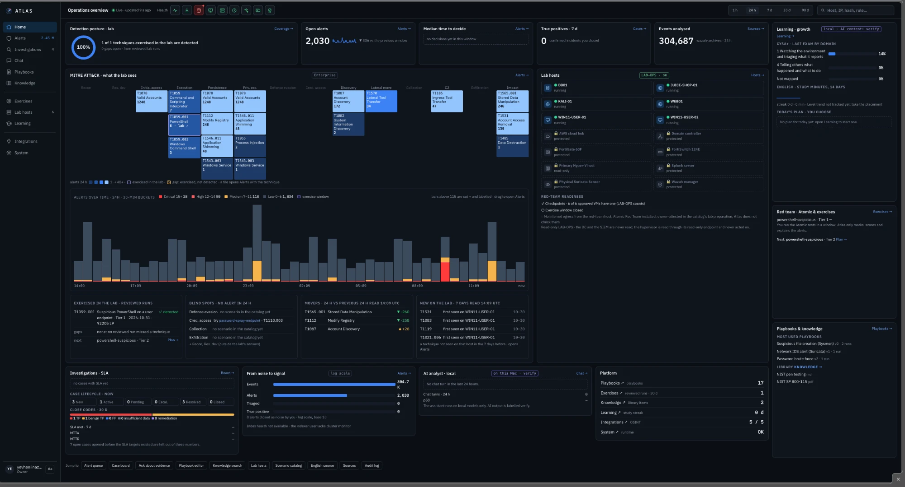
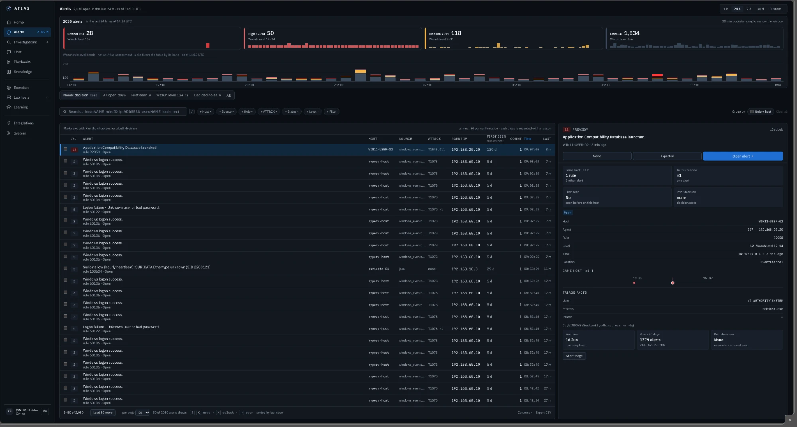
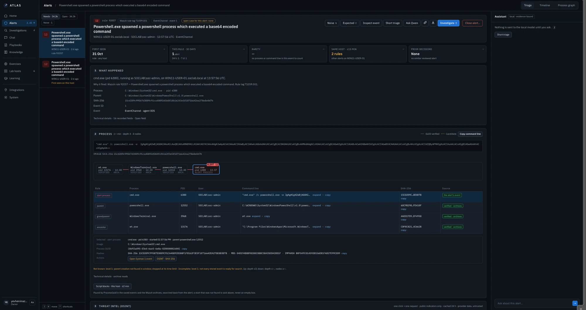
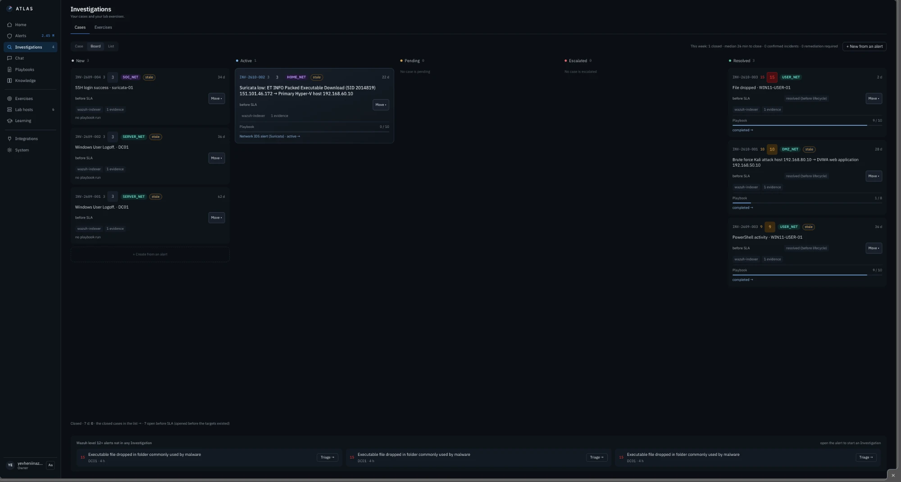
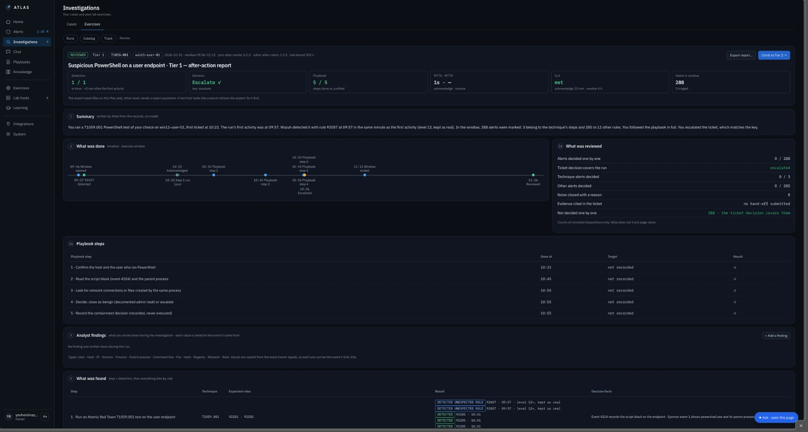
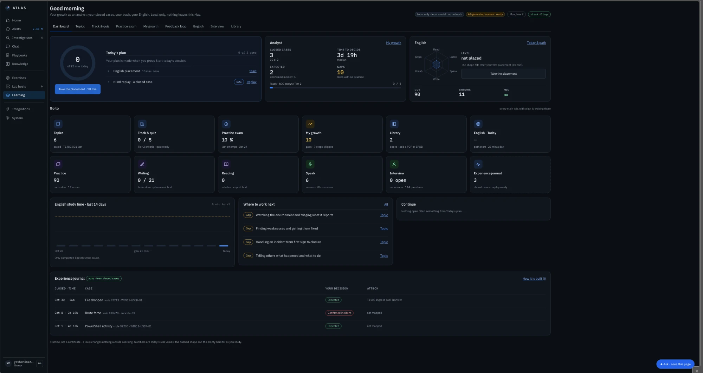
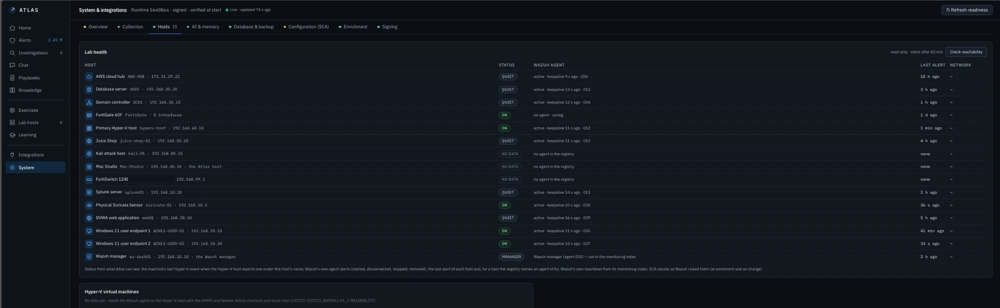

# Product Tour

A walk through the main screens of Atlas, in the order I use them during a normal day.

---

## Why I built Atlas

Wazuh in my lab produces about two thousand alerts a day. Most are routine, a few matter, and telling them apart means opening raw JSON, checking the host, the user, the process and its parent, and remembering what I decided last time. The first time I worked an alert like that by hand, it took me about 30 minutes ([case study 92205](../11-Case-Studies/powershell-file-write-92205.md)).

I also did not want a cloud AI. Command lines, user names and internal host names are exactly the data a SOC should not send to a third party. And a model that summarises logs freely will sooner or later invent a parent process or a verdict. In security work, a confident wrong answer is worse than no answer.

So Atlas keeps the AI next to the data, on my own Mac, and keeps it in its place: it reads recorded evidence and explains it. **I decide.**

## What Atlas does not do

* It does not block, isolate or change anything in the lab.
* It does not close or escalate an alert on its own.
* It does not run attacks. I run lab exercises myself.
* It does not send logs, command lines or internal names to the internet.

---

## 1. Home — the state of the lab at a glance

The first screen of the day answers one question: *is anything in my lab different from yesterday?*

* **Top row:** detection posture (how many techniques I exercised in the lab were actually detected), open alerts with their trend, median time to decide, true positives this week, and how many events Atlas analysed in the last 24 hours.
* **MITRE ATT&CK — what the lab sees:** every technique my lab produced alerts for in the window, coloured by volume. Techniques I tested in an exercise carry a "lab ✓" mark.
* **Alerts over time:** 30-minute bars coloured by severity, with exercise windows marked, so a spike is easy to place.
* **Lab hosts:** each machine with its state. Network devices and the hypervisor are shown as *protected*: Atlas only reads them.
* **Exercised · Blind spots · Movers · New on the lab:** which techniques I already tested, which tactics have no alerts at all, which rules grew or dropped against yesterday, and which techniques appeared on a host for the first time this week.

## 2. Alerts — the queue

* Four tiles by Wazuh severity (critical 15+, high 12–14, medium, low), with a timeline you can drag to narrow the window.
* Quick views: **Needs decision**, **First seen**, **Wazuh level 12+**, **Decided noise**.
* Search in plain words or with filters: `host:` `rule:` `ip:` `user:` `hash:`.
* A preview panel on the right shows the triage facts (same host ±1 h, first seen, prior decisions, rule history) without leaving the queue.
* Keyboard first: `J`/`K` to move, `X` to select, `Enter` to open. A bulk decision covers at most 50 alerts and each one is recorded with a reason.

## 3. The alert card

Everything about one alert on one page: what happened, the process chain, the decoded command, PowerShell script blocks, threat intel on click, and the raw event. This is where most of the work happens; it is described step by step in [04-Investigation-Workflow](../04-Investigation-Workflow/).

## 4. Investigations

A Kanban board of cases: New, Active, Pending, Escalated, Resolved. Each card shows the severity, the network segment, how many evidence items it has and how far the playbook got. At the bottom, level 12+ alerts that are not in any investigation yet, so nothing serious waits unseen.

## 5. Exercise report

After a purple-team exercise, Atlas writes an after-action report from the records: detection time, my decision against the answer key, the playbook, the SLA and every alert in the window. See [08-Lab-Exercises](../08-Lab-Exercises/).

## 6. Learning Centre

My growth as an analyst: today's plan, my closed cases and time to decide, English skills, interview practice, and an experience journal built automatically from my closed cases. See [07-Learning-Centre](../07-Learning-Centre/).

## 7. System

How Atlas itself is doing: data collection, lab hosts, the local AI models and memory, the database and backups. The page header always shows which signed runtime is running and that it was verified at start.

---

*A short video walkthrough will be added here.*
