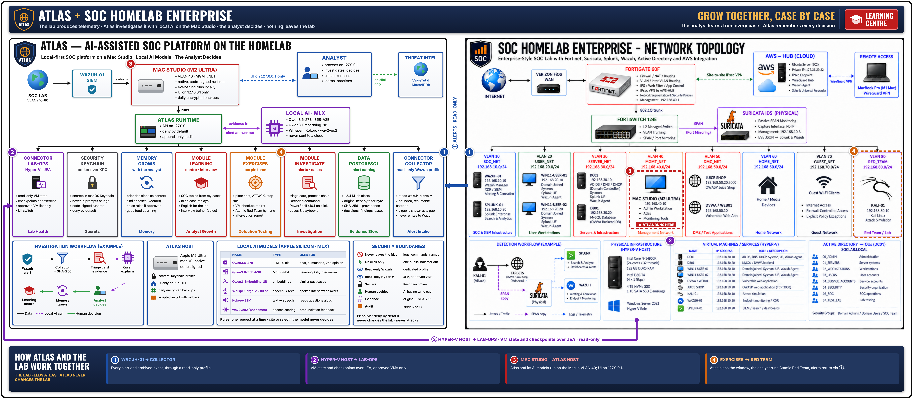
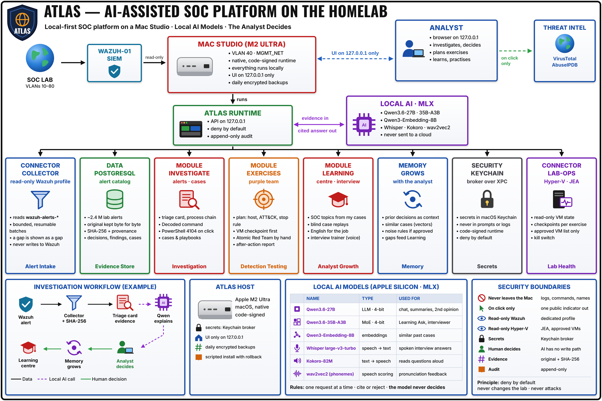

# Architecture

How Atlas is put together, where it runs, and where the trust boundaries are.

The short version: **one Mac Studio, one database, local AI models, and read-only links into the lab.** Nothing in Atlas can change the lab, and nothing private leaves the Mac.

---

## Atlas + SOC Lab

Atlas (left) runs on the Mac Studio inside my [SOC homelab](https://github.com/Evgeniy-Nazarov/soc-homelab-enterprise) (right). The numbers show how the two work together.

<div align="center">
  <a href="atlas-topology.png"></a>
</div>

| # | Link | What happens |
| - | ---- | ------------ |
| ① | **WAZUH-01 → Collector** | Every alert and archived event flows into Atlas through a read-only profile |
| ② | **Hyper-V host → LAB-OPS** | Atlas sees VM state and checkpoints over a read-only JEA endpoint |
| ③ | **Mac Studio = Atlas host** | Atlas and its AI models run on the Mac in VLAN 40; the UI listens on 127.0.0.1 only |
| ④ | **Exercises ↔ Red Team** | Atlas plans the exercise window; I run Atomic Red Team; the alerts come back through ① |

Details of each link are in [03-Lab-Integration](../03-Lab-Integration/).

---

## The Atlas platform

<div align="center">
  <a href="atlas-platform.png"></a>
</div>

### Components

| Component | What it does | Why it is built this way |
| --- | --- | --- |
| **Collector** | Reads alerts and events from Wazuh in bounded batches | Read-only, so a bug in Atlas cannot damage the SIEM |
| **PostgreSQL catalog** | Keeps every original event byte for byte with its SHA-256, plus decisions, cases, findings and the audit log | One source of truth; everything else can be rebuilt from it |
| **Atlas runtime** | The API and the web app: triage card, cases, exercises, learning | A native, code-signed runtime that is verified at every start |
| **Local AI** | Qwen models on Apple MLX, speech models for the Learning Centre | No network access, no cloud, loads only when there is enough memory |
| **Keychain broker** | The only component that can read secrets from the macOS Keychain | The app, the AI and the tests never see a key |
| **LAB-OPS** | Reads Hyper-V health over JEA | A separate, switchable component with its own kill switch |

---

## Trust boundaries

A trust boundary is a line where data or control passes between parts that trust each other differently. For each one, I decided up front what may cross it and what never may.

| Boundary | What crosses it | What never crosses it |
| --- | --- | --- |
| Lab → Mac | Wazuh alerts and events, pulled read-only | Any write to Wazuh or the lab |
| Mac → Internet | One public IP, domain or hash, on my click | Logs, private addresses, internal names |
| Atlas → AI model | The evidence Atlas picked for this question | Database access, commands, URLs |
| AI model → Atlas | A JSON answer that must cite the evidence | Any write to decisions, steps or the audit |
| Atlas → Keychain | Only through the signed broker | Secrets in logs, prompts or the browser |

---

## The life of one alert

```text
Wazuh  →  Collector stores the original (SHA-256)  →  I open the alert  →  triage card checks
       →  I ask a question  →  the AI answers with citations  →  shown only if every citation checks out
       →  I decide  →  the decision goes into the append-only audit log  →  it comes back as memory next time
```

---

## Running on one Mac

* **Memory is managed, not hoped for.** The Mac has 64 GiB. A model loads only if at least 8 GiB stay free after it loads; otherwise Atlas answers *BUSY* with the reason. An idle model unloads after 45 minutes.
* **One request at a time.** Investigations go first; learning waits.
* **Signed runtime.** The System page header always shows which runtime build is running and that its signature was verified at start.

---

## Design rules

* **PostgreSQL is the only source of truth.** Search indexes and caches can always be rebuilt from it.
* **History, not edits.** Decisions, steps and findings are added, never changed in place.
* **Named failures.** Every limit has a name; hitting one is shown on screen, never hidden.
* **Small releases.** Most installs ship without a database migration and take about two minutes of downtime.
