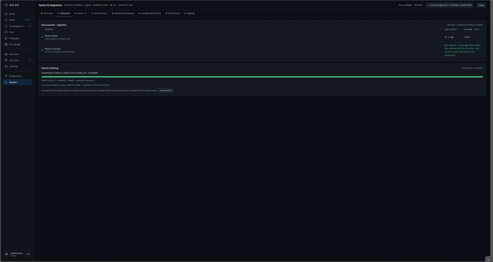
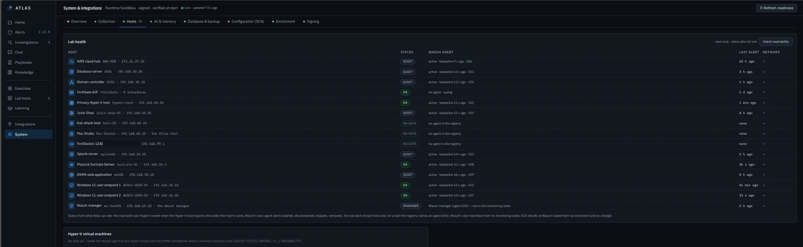
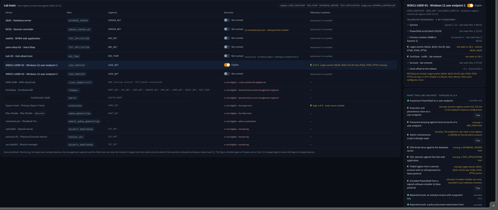
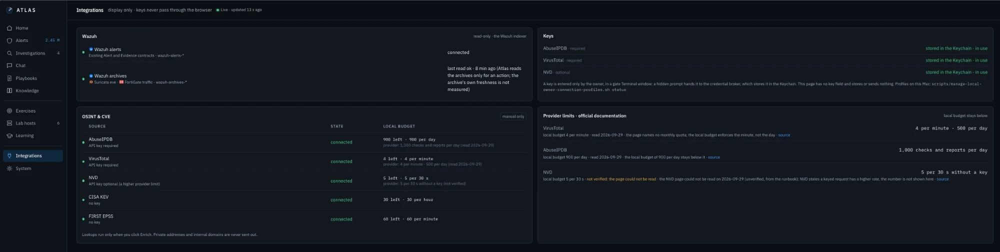

# Lab Integration

How Atlas reads my [SOC homelab](https://github.com/Evgeniy-Nazarov/soc-homelab-enterprise).

Every link between Atlas and the lab is **read-only**. Atlas can see the lab; it cannot change it. That rule is not just a promise: the accounts Atlas uses simply have no rights to change anything.

---

## ① WAZUH-01 → Collector

```text
Lab sensors and agents
        ↓
WAZUH-01 (manager + indexer)
   wazuh-alerts-*    rule hits
   wazuh-archives-*  every event, including PowerShell 4104
        ↓  dedicated read-only profile
Atlas collector  →  PostgreSQL catalog (original + SHA-256)
```

Wazuh is the SIEM of my lab. It keeps two kinds of data, and Atlas uses them differently:

* **Alerts** (`wazuh-alerts-*`): events that matched a detection rule. Atlas collects all of them continuously.
* **Archives** (`wazuh-archives-*`): every event, including the ones no rule matched. They are huge, so Atlas reads them **only when I click** something that needs them: script blocks, the process chain, the host's network around an alert. Each archive read is bounded in time and size.

**How collection stays honest:**

* Collection runs in bounded, resumable batches, each with an exact total.
* A batch that hits a limit stops with a named reason and continues later.
* **A gap is shown as a gap**, never as "nothing happened". In a SOC, "no alerts" and "no data" are completely different things.

<div align="center"></div>

*System → Collection: alerts and archives are connected; 2,446,172 stored alerts are indexed for search.*

---

## Telemetry sources

| Source | What it gives Atlas |
| --- | --- |
| Sysmon (WIN11-USER-01/02, DC01) | Process starts (1), network connections (3), file creates (11), DNS queries (22) |
| Windows Security | Logons 4624 / 4625, process creation 4688 |
| PowerShell | Script block logging 4104 |
| DC01 (SOCLAB.LOCAL) | Kerberos, logons, group changes |
| Suricata (SPAN port) | Network alerts as EVE JSON |
| FortiGate 60F | Firewall logs over syslog |
| AWS-HUB | Cloud host telemetry over IPsec |

---

## Is every host still talking?

<div align="center"></div>

A host that stops sending logs is dangerous: it looks exactly like a quiet, healthy host. So Atlas checks every host in the lab:

* **OK:** recent alerts and a live Wazuh agent.
* **QUIET:** the agent is alive, but no alert for a while (normal for a database server at night).
* **NO DATA:** nothing from this host at all, with the reason (for example, no agent in the registry).

For syslog devices without an agent (the FortiGate), freshness is checked through the archive.

---

## The lab registry

<div align="center"></div>

Atlas keeps a registry of every device: its role, its network segment, and whether it may take part in an exercise.

* **Deny by default.** Only endpoints, test applications, the database server and the red-team host can ever be marked for an exercise. Monitoring, the hypervisor, network devices, the management segment and the Atlas host can never be marked.
* **Telemetry readiness.** For each host, Atlas checks whether the logs an exercise needs actually arrive: Sysmon, PowerShell 4104, process creation, logon events, firewall and IDS traffic, and the clock offset to the indexer. If something is missing, it says exactly what will be missed before I start.

---

## ② Hyper-V host → LAB-OPS

* A JEA (Just Enough Administration) endpoint on the Hyper-V host that only allows a few read commands.
* Only VMs on an approved list.
* VM state and checkpoints, one session per cycle.
* A kill switch in Atlas turns it off completely.

Before an exercise, Atlas uses this to confirm that every approved VM has a checkpoint, so the lab can be rolled back.

## ③ Mac Studio = Atlas host

Atlas runs on the Mac Studio in VLAN 40 (MGMT_NET). The web UI listens on 127.0.0.1 only: nothing on the network can reach it.

## ④ Exercises ↔ Red Team

Atlas plans the exercise window; I run the Atomic Red Team test myself; the alerts come back through ① and are marked as exercise alerts. More in [08-Lab-Exercises](../08-Lab-Exercises/).

---

## Integrations

<div align="center"></div>

Outside the lab, Atlas talks only to threat-intelligence providers (VirusTotal, AbuseIPDB, NVD, CISA KEV, FIRST EPSS), and only when I click.

* API keys are entered once in a Terminal prompt and stored in the macOS Keychain. This page has no key field and never shows a key.
* Atlas keeps its own request budget **below** each provider's published limit.
* Private addresses and internal domains are never sent out.
