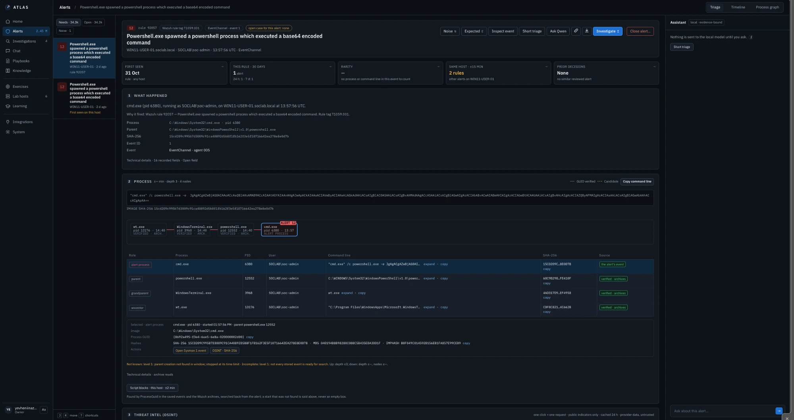
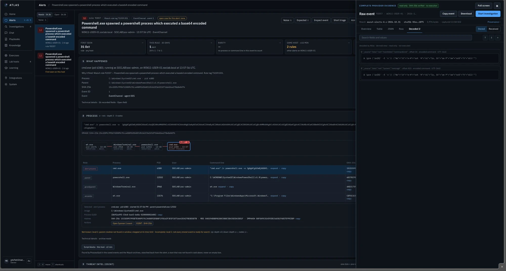
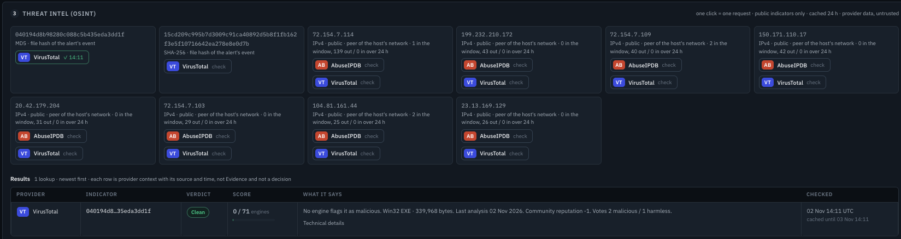
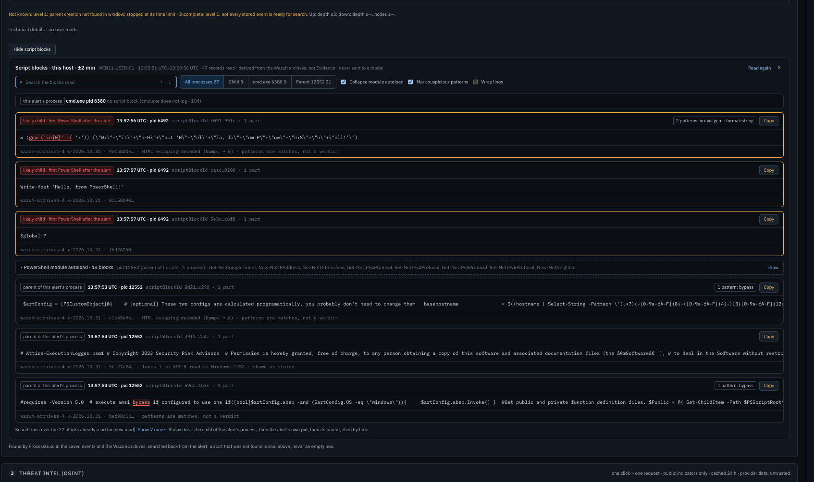
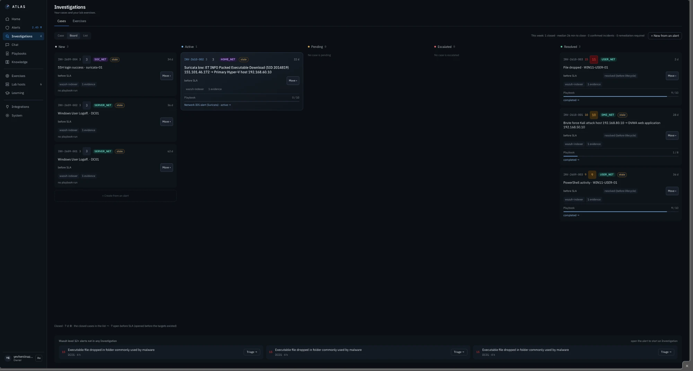
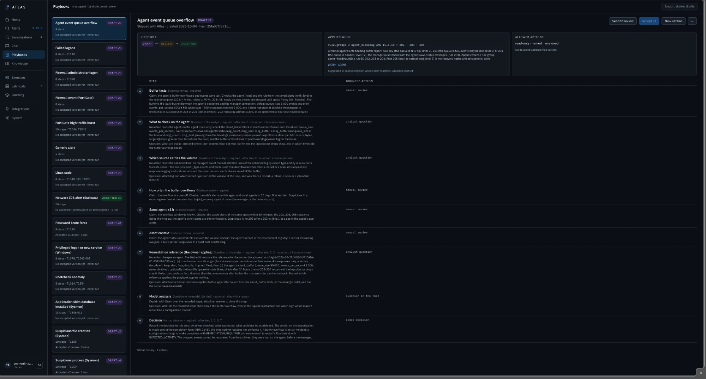
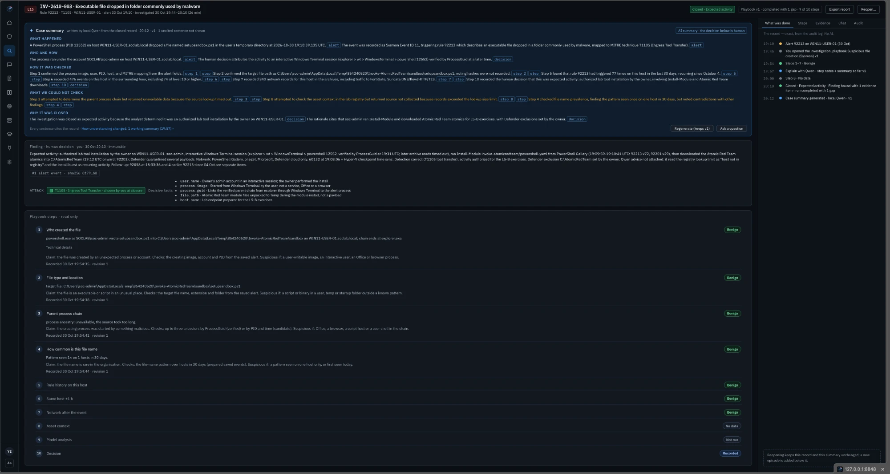
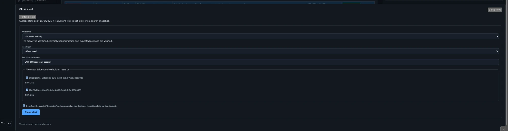

# Investigation Workflow

This is the core of Atlas: how one alert becomes one decision.

In a busy SOC, the hard part is rarely the decision. It is collecting the evidence for it, from five consoles and a dozen queries. Atlas puts that evidence on one screen, in the order an analyst needs it, and leaves the decision to me.

```text
Alert  →  Triage card  →  Evidence in one click  →  Case + playbook  →  Decision  →  Closing summary
```

<div align="center"></div>

*The alert card for rule 92057: the triage checks on top, then what happened and the verified process chain.*

---

## 1. The triage card

When I open an alert, Atlas runs a fixed set of read-only checks and shows the answers at the top of the card. Each check has a name and a time budget.

| Check | The question it answers |
| --- | --- |
| **What happened** | Which rule fired, on which host, for which user, and which process with which parent? |
| **First seen** | Is this the first time this rule fired on this host? |
| **This rule · 30 days** | How often does this rule fire? Once a month or 500 times a day? |
| **Rarity** | Is this process or command line common across my hosts, or seen once? |
| **Same host ± 15 min** | What else happened on this host around the same time? |
| **Prior decisions** | What did I decide on alerts like this before? |

**Why it matters:** these are the first questions every Tier 1 analyst asks. Atlas asks them for me, the same way every time, so I start from facts instead of from a blank search bar.

**Rule:** a check that cannot finish in time says so, with the reason. It is never dropped silently, because "no result" and "no data" are not the same thing.

---

## 2. Evidence in one click

Under the summary, each evidence tool opens with one click. Everything is read from the original events, and each view says where its data came from.

### Process chain

The verified parent → child chain as a small graph and a table: process, PID, user, command line, SHA-256, and the source of each row. Atlas links processes by their Sysmon ProcessGuid, not just by PID, because PIDs get reused. A link it could not verify is drawn as a candidate, not as a fact.

### Decoded

Attackers hide commands in Base64 and `-EncodedCommand`. Atlas decodes them next to the original and marks the result as a **derived view**: it helps me read, but the original stays the evidence.

<div align="center"></div>

*The raw event with its SHA-256, and the Decoded tab: decoded by Atlas, read-only, never executed.*

### Script blocks (PowerShell 4104)

PowerShell logs the script it actually ran, after the attacker's obfuscation layer is removed. Atlas pulls the script blocks from the same host around the alert time:

* the child process of the alert first, then the alert's own process, then its parent;
* known suspicious patterns are highlighted (for example `iex` via `gcm`, `-f` string building, `bypass`). The card says plainly: *patterns are matches, not a verdict*;
* noisy PowerShell module autoload blocks are collapsed;
* long scripts scroll inside their card, and text that was stored with a broken encoding is shown as stored, with a hint.

### Threat intel (OSINT)

VirusTotal and AbuseIPDB, for one public value (a hash, a public IP, a domain), only when I click. One click is one request, results are cached for 24 hours, and private IPs are refused. Provider data is labelled as untrusted outside data.

<div align="center"></div>

*Threat intel: the file hashes and the public peers of the host, each with its own check button. Here the file hash came back clean, 0 / 71 engines.*

### Inspector

The raw event exactly as Wazuh stored it, with its SHA-256. Every value I copy into a case comes from here.

<div align="center"></div>

*Script blocks around the 92057 alert: the child PowerShell first, suspicious patterns highlighted, module autoload collapsed.*

---

## 3. A real example: rule 92057 on WIN11-USER-01

This alert came from one of my own purple-team exercises (Atomic Red Team test T1059.001).

1. **The alert:** Wazuh rule 92057, *"Powershell.exe spawned a powershell process which executed a base64 encoded command"*, level 12, on WIN11-USER-01.
2. **Process chain:** `wt.exe → WindowsTerminal.exe → powershell.exe (12552) → cmd.exe (6380) /c powershell.exe -e JgAgACgA…`
3. **Decoded:** the Base64 turns into an obfuscated PowerShell one-liner.
4. **Script blocks:** the child PowerShell (pid 6492) logged
   `& (gcm ('ie{0}' -f 'x')) ("Wr"+"it"+"e-H"+"ost 'H"+"el"+"lo, fr"+"om P"+"ow"+"erS"+"h"+"ell!'")`.
   That is `Invoke-Expression` hidden behind `Get-Command` and string formatting, and all it does is print *Hello, from PowerShell!*. The parent (12552) shows `Invoke-AtomicTest T1059.001`.
5. **Decision:** escalated per the playbook, because this is a real attacker technique even when the payload is harmless. The exercise report later confirmed the detection came within the same minute as the activity.

Everything in this walk-through took a few clicks, without writing a single query.

---

## 4. Cases and playbooks

When an alert needs more than a look, it becomes a case.

* **Board:** all open investigations in one place, with their state.
* **Playbook:** the steps I wrote for this kind of alert. I record the outcome of each step myself, and every change is kept as history.
* **+ Finding:** copies a value (user, host, IP, hash, command line…) straight from an event field, together with that event's SHA-256. Values are never typed by hand, so every finding can be traced back to its source.
* **Completed with gaps:** if I close a case and skipped a required step, it does not pretend to be complete. It closes as *completed with gaps* and lists what was not checked.
* **Closing summary:** written from the closed record only, so it cannot include something that did not happen.

<div align="center"></div>

*The Board: cases by state, and level 12+ alerts that are not in any investigation yet.*

<div align="center"></div>

*A playbook: each step states its claim, what to check and what would be suspicious. Playbooks go from draft to review to accepted, and every version is kept.*

<div align="center"></div>

*A closed case: the case summary cites every sentence, lists what could not be checked, and the human decision is kept immutable.*

---

## 5. The decision is mine

Every alert ends in one of three decisions: **expected activity**, **false positive**, or **escalate**.

<div align="center"></div>

*Closing an alert: the outcome, whether AI was used, my rationale, and the exact evidence the decision rests on (by SHA-256). I confirm that a human made the decision, and the rationale goes into the audit.*

The local AI can explain the evidence, and every sentence it writes must cite a field (see [05-AI-Models](../05-AI-Models/)). It has no button and no route to close, escalate or change anything. Atlas remembers my decision and brings it back the next time a similar alert arrives (see [06-Memory](../06-Memory/)).
