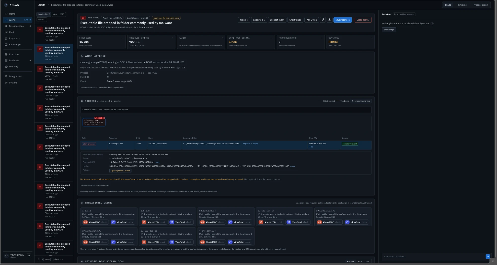
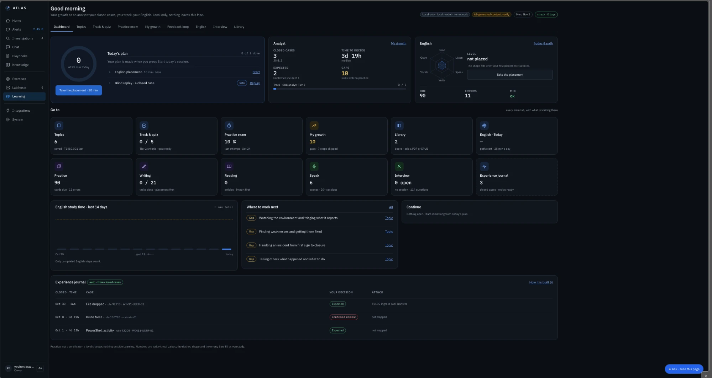

# Memory — Atlas grows with the analyst

Atlas gets more useful from my decisions, **never by retraining a model on its own.**

Every decision I record is kept as history. When a similar alert arrives later, that history comes back as context: what I decided, why, and which facts mattered. The model stays the same; what grows is the record of my work.

---

## 1. Prior decisions on the next alert

The triage card has a **Prior decisions** check. When I open an alert, Atlas looks for alerts like it that I already decided and shows the outcome and when it was. If there is none, it says *"None — no similar reviewed alert"*, which is also useful: it means I am looking at something new.

The evidence chat can cite those decisions too, so an explanation can say *"you closed similar alerts as expected activity; here is the reason you recorded"*.

**Why it matters:** in a real SOC, the same benign alert comes back every day. Remembering the last decision, and its reason, saves time and keeps decisions consistent across shifts.

<div align="center"></div>

*A real example: rule 92213 ("Executable file dropped in folder commonly used by malware") fires on DC01 when the built-in disk cleanup tool `cleanmgr.exe` runs. The rule fired 900 times in 30 days. The **Prior decisions** tile shows that I already closed 3 alerts like this one as expected activity, so I start from my own history instead of from zero. The **Coverage** tile next to it says the collection for this window is only partial, which is exactly the kind of warning that should stop me from closing too fast.*

---

## 2. Similar cases

* Closed cases are indexed with a local embedding model (Qwen3-Embedding-8B).
* Atlas finds past cases **by meaning**, not only by rule number. A PowerShell download on one host and a similar download on another can be linked even if different rules fired.
* The ranking happens in PostgreSQL, next to the rest of the data.

---

## 3. Noise rules — only with my approval

Some alerts are noise in my lab. Atlas helps me tune them, but never on its own.

* Atlas **suggests** a noise rule only when I closed the same rule on the same host as false positive or expected activity **at least 5 times, on at least 2 different days**, with no other outcome.
* High-severity alerts (Wazuh level 12 and above) are **never** covered.
* A rule becomes active only after I accept it. It has a review date and expires on its own.
* An active rule only **marks** matching alerts as "likely noise". It never hides or closes them.

---

## 4. The experience journal

<div align="center"></div>

At the bottom of the Learning dashboard, the **experience journal** lists my closed cases automatically: when, how long it took, my decision and the ATT&CK technique. It is the bridge between Memory and the Learning Centre: closed cases become the material for blind replays (see [07-Learning-Centre](../07-Learning-Centre/)).

---

## 5. Measuring it (in progress)

The next step is a **golden set**: a small set of real lab alerts with my verdicts and the facts that decided them. It will check, release after release, that the triage card still shows those decisive facts and that the suggested playbook matches mine. Raw values stay on the Mac; only hashes go into Git.

---

## The loop

```text
I decide  →  Atlas remembers  →  the next alert comes with my history  →  I decide faster and better
```

The other half of the loop is the [Learning Centre](../07-Learning-Centre/): there, the analyst grows with Atlas.
