# Learning Centre — the analyst grows with Atlas

Atlas does not only help me work. It helps me **get better at the job**, and it uses my own cases and my own lab to do it.

The idea is simple: a SOC analyst learns most from real alerts, but in daily work there is no time to stop and study them. The Learning Centre turns the work I already did into practice, and adds the two skills a SOC job also needs: English and interviews.

Everything runs on the local models. My answers and recordings never leave the Mac.

<div align="center">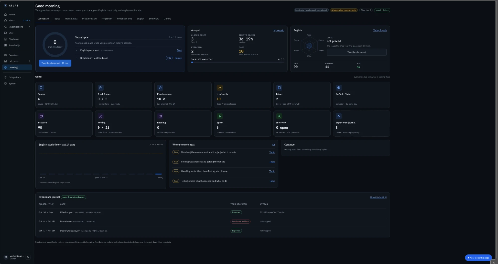</div>

*The Learning dashboard: today's plan, my analyst numbers, English skills and the experience journal from my closed cases.*

---

## 1. SOC learning

### Topics

I type a technique ID or a phrase (for example *T1480.001* or *PowerShell*), and Atlas builds a short course in six parts: **concept, telemetry, detection, hardening, practice and a quiz**.

* The ATT&CK text is quoted from a pinned offline copy of the catalog, never fetched live.
* The parts written by the model are labelled *model · verify*, and I can mark any section *Report wrong* or *Approve*.
* A panel on the right shows where the material comes from: the ATT&CK catalog, my closed cases, my lab's rules, or a section of my own books.

<div align="center">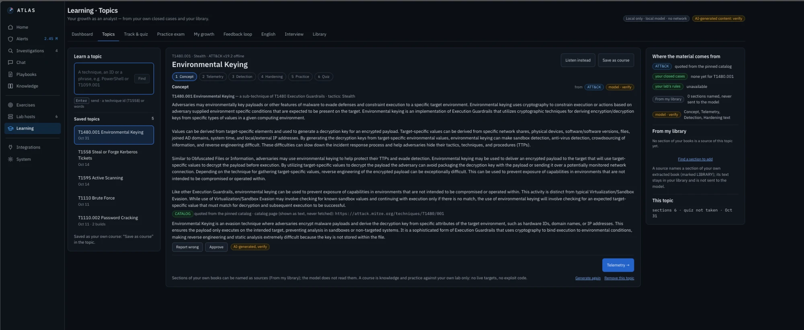</div>

*Topics: T1480.001 Environmental Keying, with the sources of each part on the right.*

### Track & quiz

A track is a goal with measurable criteria. For example, *SOC analyst · Tier 2* needs: course quizzes passed at 75 % or more, four practice sessions passed by the rubric, at least 40 closed cases covering the main domains, a mock interview, and a case report I reviewed myself. Each criterion shows its own progress bar, so "ready" is a fact, not a feeling.

<div align="center">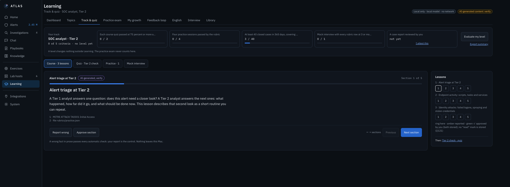</div>

*Track & quiz: the five criteria of the Tier 2 track and the first lesson, Alert triage at Tier 2.*

### Practice exam

A timed exam from my own quiz items, scored per CySA+ domain, with no feedback until the end, as in the real exam. It runs without the model, and it is clearly labelled *practice, not a certificate*.

<div align="center">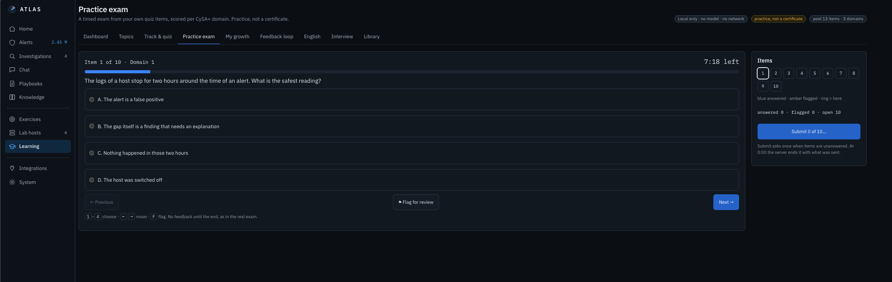</div>

*Practice exam: one item, the timer, and the item map on the right.*

### My growth — where to work next

A skills view built only from facts: my closed cases, quizzes and practice.

* **ATT&CK coverage — your evidence:** which techniques I have actually worked on, from cases, practice or quizzes.
* **Skills by CySA+ domain**, in four separate columns (cases, quiz, practice, self). They are never merged into one score, so a good quiz cannot hide a lack of real cases.
* **Where to work next:** the gaps, each with a button that opens a topic for it. A grey cell means "no evidence yet", never "bad".

<div align="center">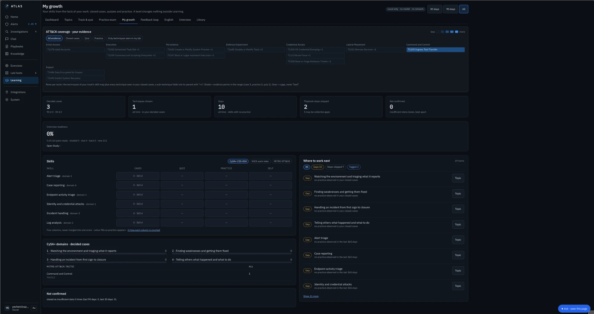</div>

*My growth: ATT&CK coverage from my own evidence, skills in four columns, and where to work next.*

### Blind replays

Atlas picks one of my closed cases (closed more than 7 days ago), **hides my old decision**, and gives me the same evidence again. I decide again, then see whether I chose the same as before and which facts I used. No grades — just an honest check of whether my judgement is consistent.

---

## 2. English for the job

English is not my first language, and a SOC works in English: tickets, reports, calls with the team.

* **Reader:** security texts and books with word help. I tap a word to see its meaning in context, its pronunciation and synonyms, and I can turn it into a flash card. New words of each chapter are listed on the right, and the dictionary works offline — no model ever sees my book.
* **Writing:** emails, incident notes, shift handovers, cover letters and STAR stories, from A1 to C1. I rate my own text first on five rubric rows, then the local model rates the same rows, and each mistake can go straight into my error journal.
* **Translate by meaning:** a whole paragraph explained in Russian by meaning, not word by word. It is labelled *AI-generated · verify*.
* **Pronunciation:** I read aloud, and a phoneme model shows the words I should practise. Only words from the text count, so the feedback stays on topic.
* **Focus sounds:** Atlas tracks the sounds that are hard for a Russian speaker (long vowels, *th*, *r / l*, *v / w*, final consonants, *-s* and *-ed* endings) across my last 30 tries each, and lets me practise one sound on real SOC terms such as *Kerberos*. Only the result is kept, never the audio.
* **Cards:** words and phrases come back on a spaced-repetition schedule (FSRS), so I review them just before I would forget them.

<div align="center">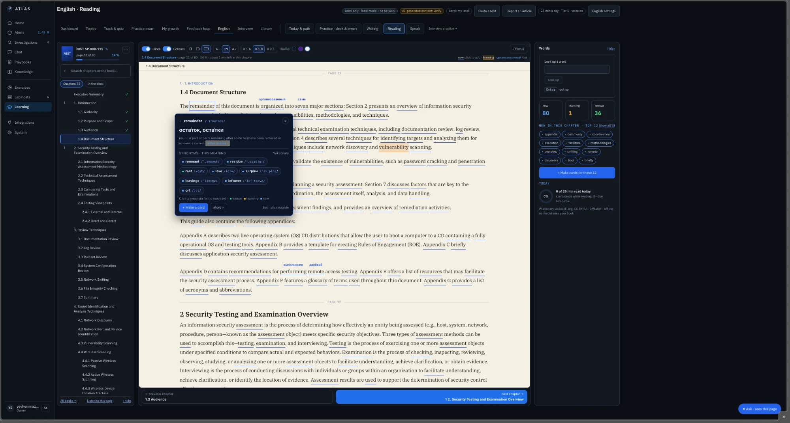</div>

*Reader: NIST SP 800-115 with hints over new words and the word card for "remainder".*

<div align="center">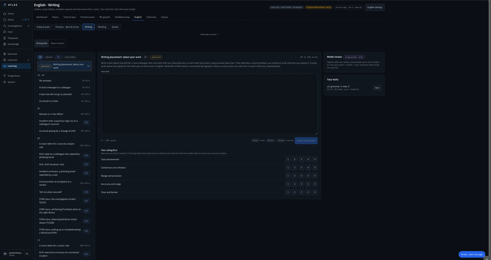</div>

*Writing: tasks by level, including SOC tasks, and "your rating first" before the model's review.*

<div align="center">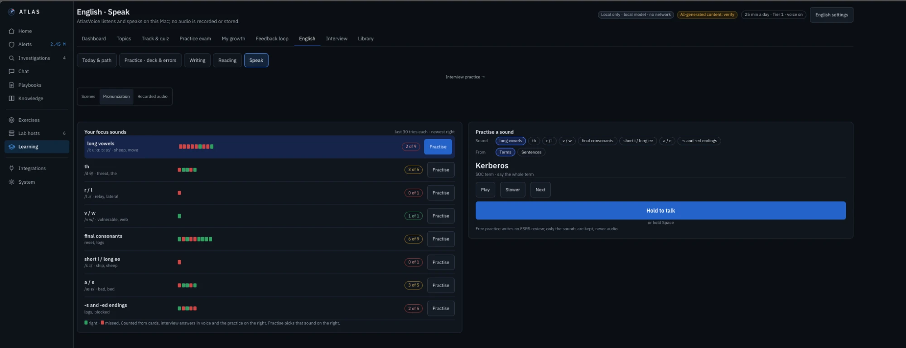</div>

*Speak: my focus sounds with the last tries (green right, red missed), and one sound practised on a SOC term.*

<div align="center">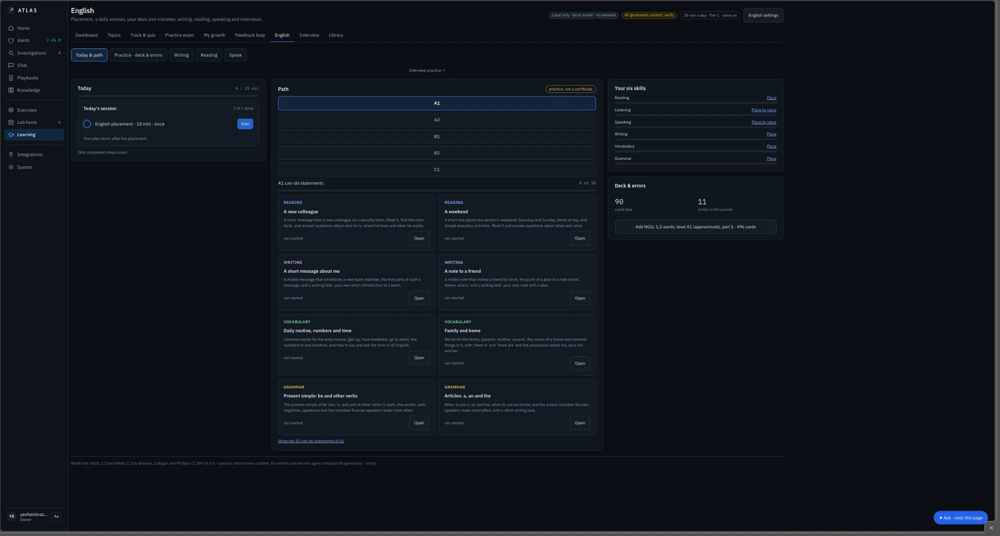</div>

*English: a path from A1 to C1, six skills, and short lessons for reading, writing, vocabulary and grammar.*

---

## 3. Interview trainer

I built this to prepare for SOC interviews with my own material: my homelab, my Atlas work and my resume.

### Study — one question at a time

Each question goes through four steps:

1. **Understand:** read the model answer, listen to it, translate it, ask about it.
2. **Key points:** confirm the 3–5 points that matter. From then on, my answers are checked against these points.
3. **Recall:** the answer is hidden and I answer out loud (or in writing). Atlas shows:
   * which key points I covered and which I missed;
   * my time against a target (for example 1:00–1:30), my pace and filler words;
   * what it heard, for this try only. The recording is not kept; the transcript is checked and then erased.
4. **Mark as studied:** the question moves to Practice and comes back on its schedule. A missed key point sends it back to Study.

<div align="center">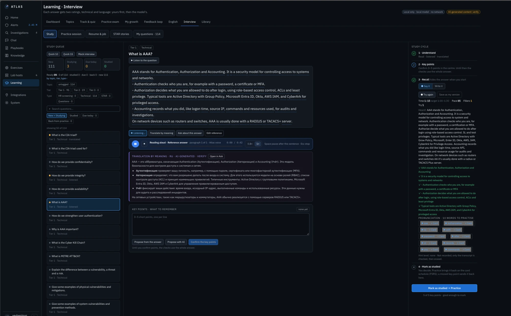</div>

*Study: the answer read aloud, the translation by meaning, and on the right my recall result — time, pace, fillers, what Atlas heard, and the key points I covered.*

### Practice session

A mock interview built from a position and a question type:

* **Position:** Tier 1, Tier 2 or Tier 3, each with its own focus (for example Tier 1 = triage and escalation, Tier 3 = threat hunting and detection improvement).
* **Type:** HR screening, technical, *think-aloud alert* (I talk through a real alert), STAR stories, my own questions, or questions from my resume.
* **Mode:** text, voice, timed voice, or a full mock interview with the light local model as the interviewer. A *telephone line* option for the voice modes, because many first interviews are phone calls.

Each answer gets two ratings, technical and language: **mine first, then the model's.** I am "ready" for a tier when the model rated every technical answer 4 or higher in my last three sessions.

<div align="center">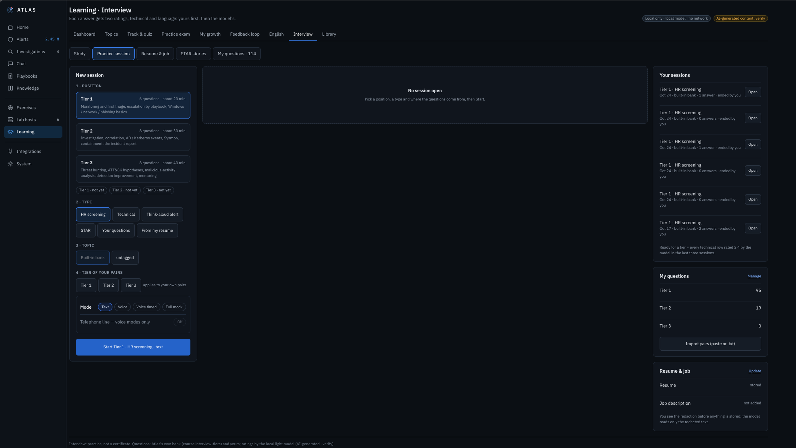</div>

*Practice session: position, question type, topic, tier and mode.*

### My resume, safely

Before anything from my resume is stored, I see what will be redacted. The model only reads the redacted text.

---

## 4. Rules

* **Work goes first.** When an investigation needs the model, learning waits.
* **AI output is labelled.** A model's rating or review is *AI-generated · verify*: it is not a grade and not a decision.
* **My data stays mine.** Recordings are not stored, and nothing is sent to a cloud service.

---

## The loop

```text
Every case  →  practice from my own work  →  a sharper analyst  →  better decisions in Atlas
```

The other half of the loop is [Memory](../06-Memory/): there, Atlas grows with the analyst.
