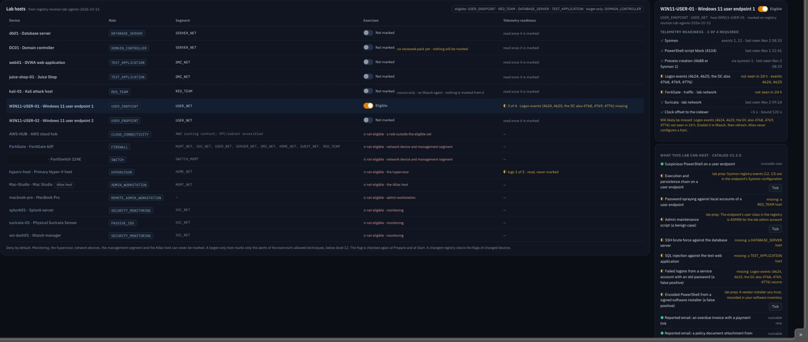
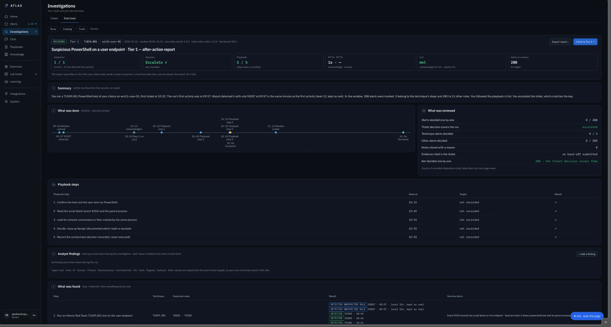
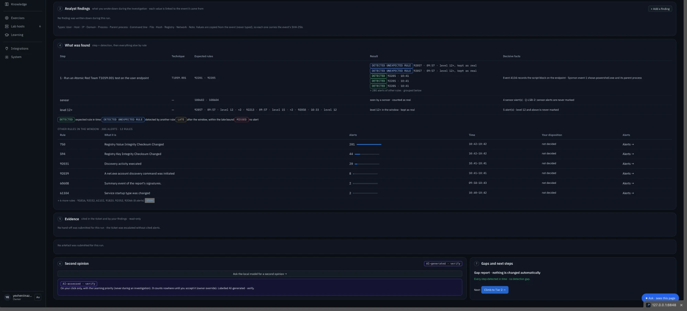
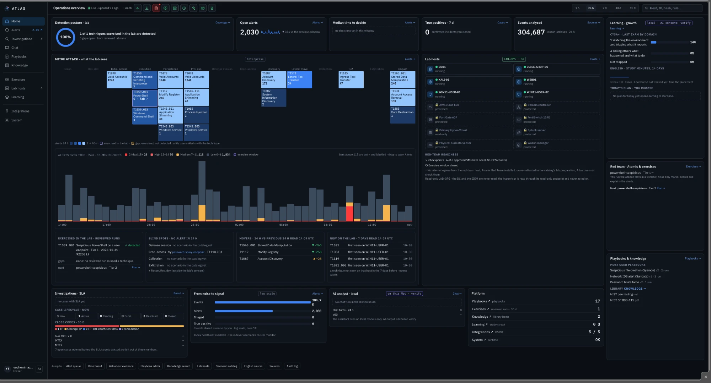

# Lab Exercises (Purple Team)

I test my own detections in my own lab. **Atlas never runs attacks.** I do, by hand, inside a planned window, against machines that are allowed to be targets.

A detection rule you never tested is a guess. Purple-team exercises turn that guess into a measured result: did the alert fire, how fast, and did I make the right decision?

---

## The cycle

```text
Plan  →  VM checkpoint  →  Window opens  →  I run Atomic Red Team  →  Alerts are marked  →  Investigate  →  After-action report
```

1. **Plan** with rules of engagement: the target host, the MITRE ATT&CK technique, the expected detection rules, and a stop condition.
2. **Checkpoint** every approved VM on the Hyper-V host first, so the lab can be rolled back. Atlas checks this over LAB-OPS before the window opens.
3. **Window:** Atlas marks alerts from the target host in the window as exercise alerts and keeps them out of real metrics. Wazuh level 12 and above are **never** marked: a serious alert always stays a real alert.
4. **Run** the Atomic Red Team test by hand on the endpoint.
5. **Investigate** it like a real ticket: triage card, playbook, findings, decision.
6. **Report:** Atlas writes the after-action report from the records.

---

## What the lab can host

<div align="center"></div>

Before an exercise can be planned, Atlas checks the lab itself:

* **Which hosts may take part.** Deny by default: only user endpoints, test applications, the database server and the red-team host can be marked. Monitoring, network devices, the hypervisor and the Atlas host never can.
* **Whether the telemetry is there.** For the target host: Sysmon, PowerShell 4104, process creation, logon events, firewall and IDS traffic, clock offset. If something is missing, Atlas says what the exercise will miss.
* **Which scenarios are runnable now.** The catalog lists scenarios (for example *Suspicious PowerShell on a user endpoint*, *Password spraying against local accounts*, *SSH brute force against the database server*, reported phishing emails) and shows for each one what the lab still needs.
* **Red-team readiness.** Checkpoints exist for every approved VM, and the red-team host has no internet egress.

---

## The after-action report

Modelled on an incident "lessons learned" report (NIST SP 800-61) and on a purple-team test report.

<div align="center"></div>

**A real run: T1059.001, Suspicious PowerShell on a user endpoint, Tier 1.**

* **Header tiles:** Detection 1 / 1 in time, +0 min after the first activity. Decision *Escalate*, which matches the answer key. Playbook 5 / 5 steps. SLA met. 288 alerts in the window.
* **Summary:** one paragraph written **by Atlas from the records, without a model**: *"Wazuh detected it with rule 92057 at 09:57 in the same minute as the first activity (level 12, kept as real). In the window, 288 alerts were marked: 3 belong to the technique's steps and 285 to 12 other rules. You followed the playbook in full. You escalated the ticket, which matches the key."*
* **What was done:** a timeline from the window opening to the review, with every playbook step.
* **What was reviewed:** counts of recorded decisions only. Atlas does not track page views, so it never invents an "opened" count.

<div align="center"></div>

* **What was found:** for each step, the technique, the expected rules and what actually fired, as *DETECTED*, *DETECTED (unexpected rule)*, *LATE* or *MISSED*. Below it, the other 285 alerts in the window are grouped by rule with a link to each group, so the noise of an exercise is visible without flooding the page.
* **Level 12+:** high-severity alerts in the window get their own row, "kept as real".
* **Evidence:** the events cited in the ticket, with their SHA-256.
* **Second opinion:** on my click only, the local model writes a structured review (assessment, done well, could improve, not checked). Every point must cite a record of this report, or it is refused. It is labelled *AI-generated · verify*.
* **Gaps and next steps:** for this run, "every step detected in time, no detection gap", and the next level: *Climb to Tier 2*.

---

## MITRE ATT&CK coverage

<div align="center"></div>

Home shows the ATT&CK matrix as the lab sees it. A technique I tested in an exercise and detected carries a **"lab ✓"** mark; a technique I exercised but did not detect is marked as a gap. Next to it, **Blind spots** lists the tactics with no alerts at all, so I know where to plan the next exercise.

---

## Example

The T1059.001 exercise: an obfuscated, Base64-encoded PowerShell command on WIN11-USER-01, decoded in Atlas from event 4104 and escalated. The full walk-through is in [04-Investigation-Workflow](../04-Investigation-Workflow/#3-a-real-example-rule-92057-on-win11-user-01).
