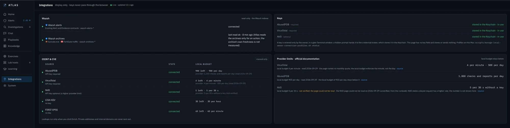
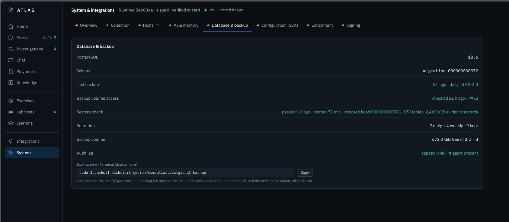

# Security

Atlas runs an AI model next to real security logs. So the first rule was: **the AI can never be the source of truth, a way to change things, or a way for data to leave.**

This page describes how Atlas protects the evidence, the secrets and itself.

---

## 1. The AI never decides

| Rule | How |
| --- | --- |
| Decisions are human | Only I can close, escalate or record a step. AI output has no route there |
| Every claim is checkable | Every sentence must cite real evidence, or the answer is rejected |
| Atlas counts, the AI explains | Frequency, rarity and process chains are computed, not guessed |
| No hidden AI | The model runs only when I ask. No background jobs, no agent loop |
| Unknown stays unknown | Missing data is shown as a gap, not as "nothing found" |

## 2. Log text is data, not commands

A log can contain text an attacker wrote: a file name, a User-Agent, a PowerShell comment. Atlas passes it to the AI as labelled data, removes hidden model control tokens, and flags the attempt on the answer card. Model text shown on a page is also checked: no commands, no links.

## 3. Deny by default

* Every action needs a named permission.
* The web UI listens on 127.0.0.1 only. Nothing on the network can reach it.
* The AI model has no network access at all.
* Lab hosts are not eligible for exercises unless their role allows it (see [08-Lab-Exercises](../08-Lab-Exercises/)).

---

## 4. Evidence integrity

In a SOC, evidence you cannot trust is worse than no evidence. Atlas treats the original event as sacred.

| What | How |
| --- | --- |
| Original event | Kept byte for byte with its SHA-256 |
| Derived views | Decoded commands, translations and AI answers are labelled as derived |
| Findings | Copied from an event field, with that event's SHA-256 — never typed by hand |
| History | Decisions, findings and steps are append-only; database triggers refuse edits |

---

## 5. Secrets

* API keys live in the macOS Keychain.
* A key is entered once, in a Terminal window, at a hidden prompt that hands it straight to a small signed **credential broker**. The web page has no key field.
* Only that broker can read the keys: not the app, not the AI, not the tests.
* Keys are never written to logs, prompts or the browser.
* Atlas keeps its own request budget below each provider's published limit.

---

## 6. Signed and checked

* The runtime, the web app and the broker are code-signed.
* Every start and every install checks the signature. A mismatch stops Atlas instead of letting it run in a degraded state.
* The System page header always shows the running build and "verified at start".

---

## 7. Backups you can actually restore

* A daily encrypted backup of the PostgreSQL catalog (about 49 GiB).
* **A backup counts only after a real test restore.** The last restore check rebuilt 177 tables and 2.4 million evidence records in 77 minutes.
* Retention: 7 daily and 4 weekly backups.
* The audit log is append-only, and the page checks that its database triggers are present.

---

## 8. Local-first

* Logs, private addresses and internal names stay on the Mac.
* Threat intel is one public value per click; private IPs and internal domains are refused.

---

## Not built yet

* **Users and roles** beyond the single owner — in progress (see [13-Roadmap](../13-Roadmap/)).
* **Any action toward the lab** (for example a firewall block) — only with approval, a dry run, a time limit and automatic rollback.
