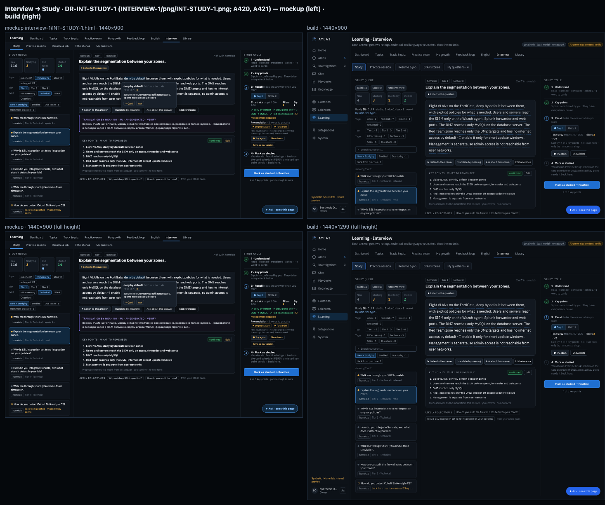

# Engineering Process

How Atlas is built: small steps, written decisions, and nothing ships without proof.

I build Atlas with AI coding assistants. That makes discipline more important, not less: AI-written code is fast, confident and sometimes wrong. The process below is how I keep it honest.

---

## 1. Decisions are written down

* **177 Architecture Decision Records (ADRs)** in the released code. Every important choice — what the model may do, how secrets are kept, how a release is rolled back — is written as an ADR **before** it is built.
* A decision log and a current-state file live in the repository, so work can always continue from the repo alone, by me or by a new assistant session.
* When a new idea conflicts with an accepted ADR, the work stops until a new ADR settles it.

---

## 2. Two roles: executor and reviewer

| Role | Does | Never does |
| --- | --- | --- |
| **Executor** (AI) | Writes the plan, the code, the tests and the install runbook | Draws designs, approves its own work, touches production without my "go" |
| **Reviewer** (AI) | Checks every plan and release against the ADRs, reads the code and the screenshots, draws the screen designs | Writes production code |
| **Me** | Approves the architecture, types every password, runs the install, does the final checks | — |

Every question, answer and decision goes through the repository as a numbered entry, so the history of *why* is never lost in a chat window.

---

## 3. Design first

* Every new screen starts as a **mockup** drawn before any code.
* The build is compared side by side with the mockup (a **mockup / build pair**) and a checklist before it is accepted.
* Visual baselines and a layout matrix (135 screen states in the last release) catch unplanned changes, like text overflowing a card or a button hidden under another.

<div align="center"></div>

*A real mockup / build pair from release v1.9.17: the Interview → Study screen as drawn (left) and as built (right), at the same size, with test data.*

---

## 4. Tests

The numbers from the last release (v1.9.17):

| Layer | What runs |
| --- | --- |
| Backend | 10,290 tests |
| Frontend | 1,879 tests |
| End-to-end | 261 browser stages through the real delivery server |
| Visual | 48 screenshot baselines + 135 layout states |
| Database | Migrations and integration tests on a disposable PostgreSQL |

Then the same suite runs again in **CI on the exact commit** that will be installed.

---

## 5. Releases

```text
Full test gate  →  CI on the exact commit  →  signed artifacts  →  written runbook  →  install windows  →  live checks  →  rollback ready
```

* **About 50 releases** so far, most without a database migration.
* An install is split into small **gate windows**. Each window does one thing and prints PASS lines; anything that is not PASS stops the release.
* Downtime of the last release: **1 min 51 s**.
* A migration release first takes a verified encrypted backup and is rehearsed with a rollback.
* After every install, I check each fixed item by hand on my own Mac, one at a time.

---

## 6. What the process caught recently

* A gate that waited for a password while the cutover was already running, so it measured nothing. The fix: the cutover now refuses to start until the monitor is sampling.
* A CI test shard that ran close to its time limit and was cancelled on a slow runner. Not "a flake": the shards were rebalanced from measured times.

Release history: [CHANGELOG.md](../CHANGELOG.md)
