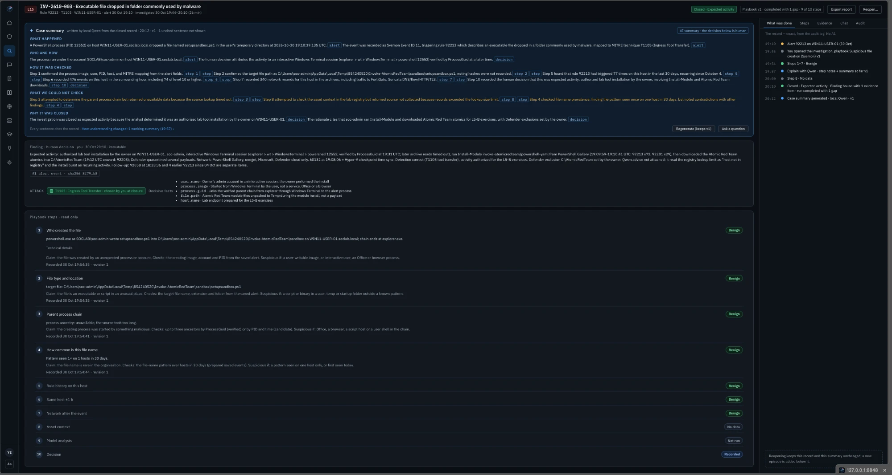

# Case Studies

Real alerts and exercises from my lab, worked end to end in Atlas. Each one shows a different kind of decision.

---

## 1. Hydra vs DVWA — a true positive with no compromise

[Read the case →](hydra-vs-dvwa.md)

A password-guessing attack from my Kali machine (KALI-01) against a deliberately vulnerable web app (DVWA). Suricata on the mirror port saw 25 login attempts with the User-Agent `Mozilla/5.0 (Hydra)`, and my own Wazuh rule raised a level 10 alert.

**What it shows:** how a *network* alert reads differently from a Windows process alert (attacker → target, seen by a sensor), why private addresses are never sent to threat-intel providers, and how I confirmed that every attempt was redirected back to the login page, so nobody got in.

**Decision:** confirmed incident (an attack happened), no compromise.

---

## 2. PowerShell file write (92205) — expected activity

[Read the case →](powershell-file-write-92205.md)

A PowerShell process running as SYSTEM wrote a script that looked like a loader. It turned out to be the Wazuh agent's own configuration check.

**What it shows:** the case that started Atlas. By hand, it took me about 30 minutes to collect the evidence; the same questions are now answered by the triage card in seconds.

**Decision:** expected activity.

---

## 3. Executable file dropped (92213) — the Atomic Red Team install

A level 15 alert on WIN11-USER-01: *"Executable file dropped in folder commonly used by malware"*. PowerShell had written `setupsandbox.ps1` into a temporary folder.

* The playbook *Suspicious file creation (Sysmon)* ran 10 steps: who created the file, the file type and location, the parent chain, how common the file name is, the rule's history on the host, the host's activity ±1 hour, and its network traffic.
* The chain showed an interactive session: `explorer → Windows Terminal → powershell` under my lab admin account, at the time I was running `Install-Module invoke-atomicredteam`.
* Two steps could not be completed (the parent lookup timed out; the asset context was missing). The case says so openly: **completed with 1 gap**.
* The **case summary** was written by the local model from the closed record. Every sentence cites a step or the decision, and a section *What we could not check* lists the gaps.

**Decision:** expected activity — an authorised lab tool installation. Closed in 26 minutes.

---

## 4. T1059.001 exercise — encoded PowerShell, escalated

A purple-team exercise: an obfuscated, Base64-encoded PowerShell command on WIN11-USER-01. Atlas decoded it, the script block (4104) showed `Invoke-Expression` hidden behind `Get-Command`, and the after-action report confirmed detection in the same minute as the activity.

**Read:** the walk-through in [04-Investigation-Workflow](../04-Investigation-Workflow/#3-a-real-example-rule-92057-on-win11-user-01) and the report in [08-Lab-Exercises](../08-Lab-Exercises/).

**Decision:** escalate, matching the exercise's answer key.
