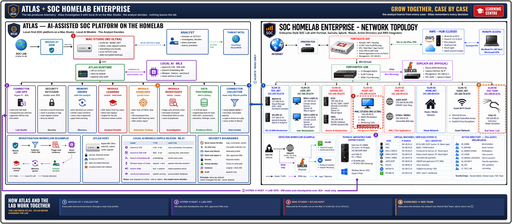

# Atlas — AI-Assisted SOC Platform


> **Grow together, case by case.**
> A SOC platform on my own homelab: the analyst learns from every case, and Atlas remembers every decision.

---

## Project Overview

Atlas is the SOC platform I built on top of my [SOC Homelab Enterprise](https://github.com/Evgeniy-Nazarov/soc-homelab-enterprise).

It reads every alert from Wazuh, puts all the evidence for an alert on one screen, and lets a local AI model explain what happened. **I make every decision.** Atlas remembers those decisions, and its **Learning Centre** turns my own cases into practice.

Everything runs on one Mac Studio. No cloud AI, and no logs leave the lab.

Atlas helps me:

* 🔎 investigate alerts faster, with the evidence in one place
* 🧪 test my detections with safe exercises in my own lab
* 🎓 learn from my own cases, every day
* 🤖 use AI safely: it explains and cites, it never decides

---

## Atlas + SOC Lab Topology

<div align="center">
  <a href="02-Architecture/atlas-topology.png">
    
  </a>
</div>

---

## How It Works

```text
SOC lab (Windows + Sysmon, DC01, Suricata, FortiGate, AWS)
        ↓
Wazuh  (alerts + archives)
        ↓  read-only
Atlas collector  →  PostgreSQL catalog (original event + SHA-256)
        ↓
Triage card  →  local AI explains, citing every sentence
        ↓
The analyst decides  →  Atlas remembers  →  Learning Centre
```

---

## How Atlas and the Lab Work Together

| # | Link | What happens |
| - | ---- | ------------ |
| ① | **WAZUH-01 → Collector** | Every alert and archived event flows into Atlas through a read-only profile |
| ② | **Hyper-V host → LAB-OPS** | Atlas sees VM state and checkpoints over JEA, read-only |
| ③ | **Mac Studio = Atlas host** | Atlas and its AI models run on the Mac in VLAN 40; the UI is on 127.0.0.1 only |
| ④ | **Exercises ↔ Red Team** | Atlas plans the exercise window; I run Atomic Red Team; the alerts come back through ① |

**Atlas reads the lab. It never changes the lab and never runs attacks.**

---

## Core Stack

| Category        | Technology                                                |
| --------------- | --------------------------------------------------------- |
| Data source     | Wazuh (alerts + archives, read-only)                      |
| Backend         | Python, FastAPI                                           |
| Frontend        | Next.js, TypeScript                                       |
| Database        | PostgreSQL                                                |
| Local AI        | Qwen3.6-27B · Qwen3.6-35B-A3B · Qwen3-Embedding-8B (MLX)  |
| Voice           | Whisper large-v3-turbo · Kokoro-82M · wav2vec2            |
| Host            | Mac Studio (M2 Ultra), native code-signed runtime         |
| Secrets         | macOS Keychain behind a dedicated broker                  |
| Lab             | FortiGate · Suricata · Active Directory · Hyper-V · AWS   |

---

## What Atlas Does

### 🔎 Investigate

* One triage card per alert: what happened, user, host, process and parent
* The verified process chain, the decoded command, PowerShell script blocks (4104) in one click
* How often the rule fires, how rare it is, and what I decided last time
* Threat intel (VirusTotal, AbuseIPDB) only when I click
* Cases, playbooks, findings and a closing summary

### 🧪 Test My Detections

* Plan an exercise: host, MITRE ATT&CK technique, stop rule, VM checkpoint
* I run the Atomic Red Team test myself — Atlas never runs attacks
* Exercise alerts are marked and kept out of real metrics
* An after-action report: what was detected, what was missed, what I did, the evidence

### 🤖 Local AI That Shows Its Work

* Every sentence must point to a real field in the event, or the answer is rejected
* Event text is treated as data, never as instructions
* An optional second opinion on an exercise report, labelled "AI-generated"
* **The model never decides.** It has no way to close, escalate or change anything

### 🎓 Learning Centre — the analyst grows with Atlas

* SOC topics and MITRE ATT&CK, with progress and where to work next
* **Blind replays:** re-work a closed case without seeing my old answer
* English for the job: reading, words, pronunciation
* **Interview trainer:** study a question, answer out loud, get feedback on key points, timing and pronunciation

### 🧠 Memory — Atlas grows with the analyst

* My past decisions show up as context on the next similar alert
* Similar cases are found by meaning, not only by rule number
* Noise rules are suggested from my decisions and used only when I approve them

### 🛡️ Secure by Design

* UI on 127.0.0.1 only, code-signed runtime checked at start
* Secrets in the macOS Keychain, never in prompts or logs
* Deny by default, named permissions, append-only audit
* Daily encrypted backups with a checked restore, every install has a rollback

---

## Current Status

| Component                                  | Status               |
| ------------------------------------------ | -------------------- |
| Alert collection from Wazuh                | ✅ Operational        |
| Triage card, process chain, Decoded        | ✅ Operational        |
| PowerShell script blocks (4104)            | ✅ Operational        |
| Cases, playbooks, findings                 | ✅ Operational        |
| Lab exercises + after-action reports       | ✅ Operational        |
| Local AI chat with citations               | ✅ Operational        |
| Learning Centre + interview trainer        | ✅ Operational        |
| LAB-OPS (Hyper-V health, read-only)        | ✅ Operational        |
| Backups with restore check                 | ✅ Operational        |
| Users and roles                            | 🛠️ In progress        |

---

## Numbers

| | |
| --- | --- |
| Alerts collected from the lab | ~2.4 million |
| Automated tests in every release | 10,000+ backend · 1,800+ frontend · browser end-to-end · visual checks |
| Architecture decisions (ADRs) | 177 |
| Release process | full test gate → CI on the exact commit → scripted install with rollback |

---

## Skills Demonstrated

| Area | Skills |
| --- | --- |
| Security Operations | Alert triage, process tree and command-line analysis, PowerShell 4104, timelines, cases and playbooks |
| Detection Engineering | Purple-team exercises, Atomic Red Team, MITRE ATT&CK coverage, noise tuning, after-action reports |
| Security Engineering | Least privilege, read-only integrations, secrets in the Keychain, SHA-256 evidence, audit, backups and rollback |
| AI for Security | Local LLMs on Apple silicon, answers grounded in evidence, safe handling of log text, human-in-the-loop |

---

## Repository Structure

| Section                   | Description                                                   |
| ------------------------- | ------------------------------------------------------------- |
| 01-Product-Tour           | The main screens and a short video                            |
| 02-Architecture           | Topology, components, trust boundaries                        |
| 03-Lab-Integration        | How Atlas reads the lab: Wazuh → Collector, Hyper-V → LAB-OPS |
| 04-Investigation-Workflow | Triage card, process chain, Decoded, script blocks, cases     |
| 05-AI-Models              | Local models and how every answer is tied to evidence         |
| 06-Memory                 | How Atlas grows with the analyst                              |
| 07-Learning-Centre        | How the analyst grows with Atlas                              |
| 08-Lab-Exercises          | Purple-team exercises, MITRE ATT&CK coverage, reports         |
| 09-Security               | How Atlas protects itself and keeps evidence intact           |
| 10-Engineering-Process    | ADRs, tests, design-first, releases with rollback             |
| 11-Case-Studies           | Real alerts and exercises, end to end                         |
| 12-Lessons-Learned        | What broke and what it taught me                              |
| 13-Roadmap                | What's next                                                   |

Release history: [CHANGELOG.md](CHANGELOG.md)

------------------------- | ----------------------------------------------------- |
| 01-Overview               | What Atlas is, why I built it, what it does not do    |
| 02-Architecture           | Topology, components, trust boundaries                |
| 03-Telemetry-Pipeline     | From the lab sensors through Wazuh into Atlas         |
| 04-Investigation-Workflow | Triage card, evidence, decoding, script blocks, cases |
| 05-AI-Models              | Local models and how answers are tied to evidence     |
| 06-Lab-Exercises          | Purple-team exercises and after-action reports        |
| 07-Lab-Operations         | Read-only Hyper-V health and lab sensors              |
| 08-Security               | How Atlas protects itself                             |
| 09-Evidence-Integrity     | Hashes, provenance, findings                          |
| 10-Engineering-Process    | ADRs, tests, design-first, AI-assisted development    |
| 11-Learning-Centre        | How Atlas teaches its analyst                         |
| 12-Case-Studies           | Real alerts and exercises, end to end                 |
| 13-Metrics                | Numbers                                               |
| 14-Roadmap                | What's next                                           |
| 99-Archive                | Earlier versions                                      |

---

## Certifications & Training

* CompTIA Security+
* Cydeo SOC Analyst Program
* RangeForce SOC / Cybersecurity Training

---

## Roadmap

* Users and roles
* One controlled response action (a single firewall block) with approval, a dry run and automatic rollback
* A mobile app for the Learning Centre
* More exercises and case studies

---

## Summary

Atlas turns my SOC homelab into a working SOC: alerts come in from Wazuh, the evidence is ready, a local AI explains it, and I decide. Every case makes me a better analyst, and every decision makes Atlas more useful.

**Grow together, case by case.**

The lab Atlas runs on: [soc-homelab-enterprise](https://github.com/Evgeniy-Nazarov/soc-homelab-enterprise)

*Built by Yevhenii Nazarov with AI coding assistants, under my architecture, security rules and review.*
